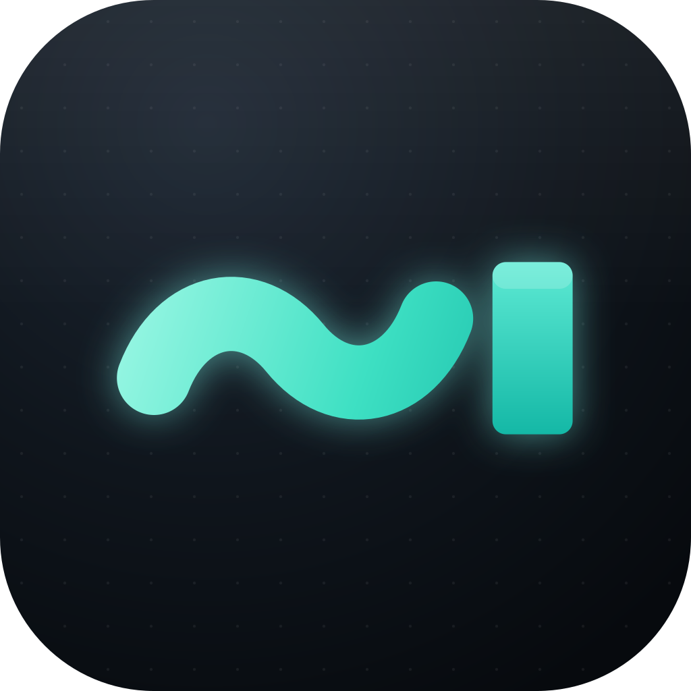
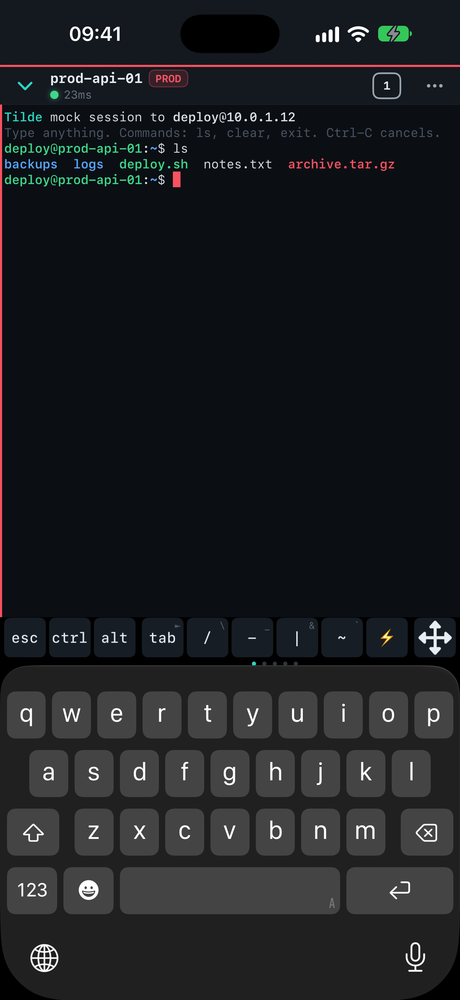
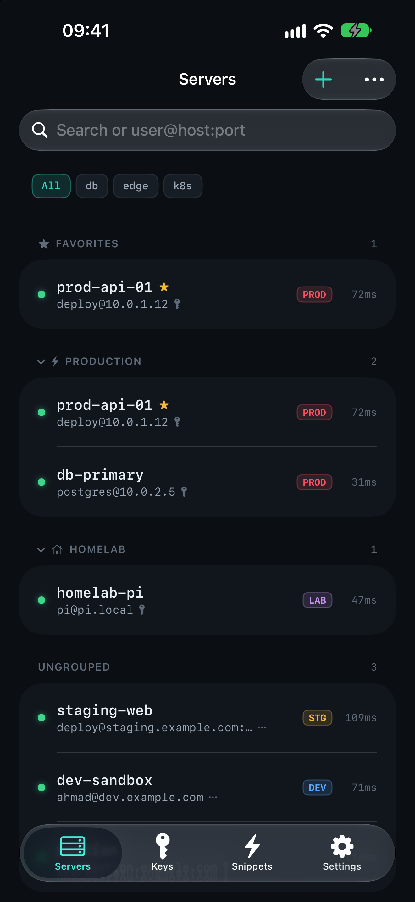
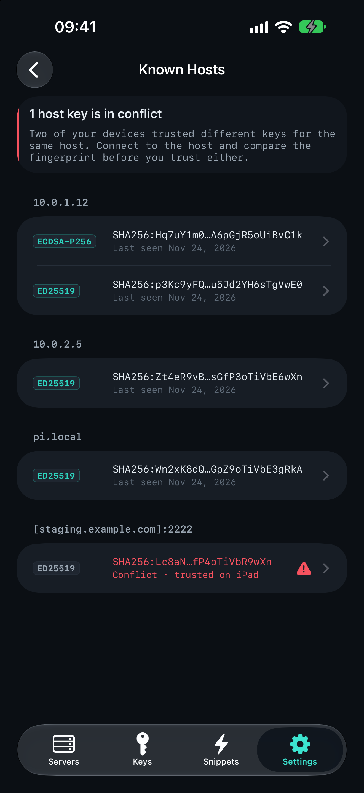
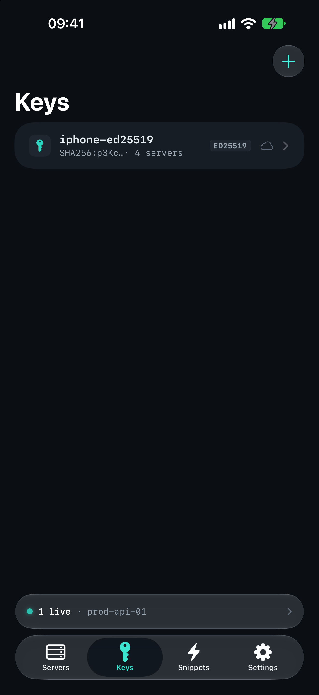
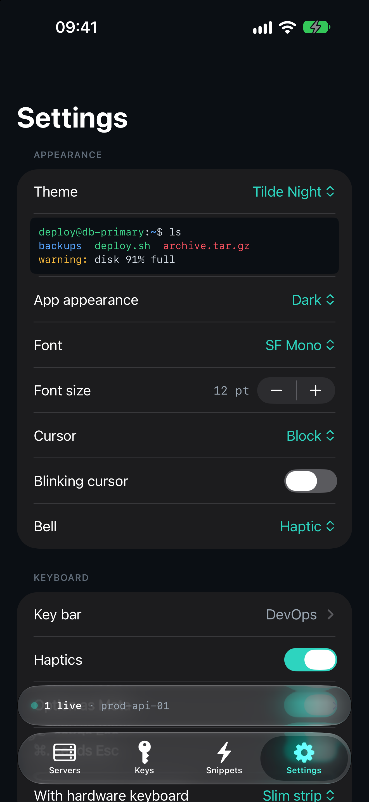
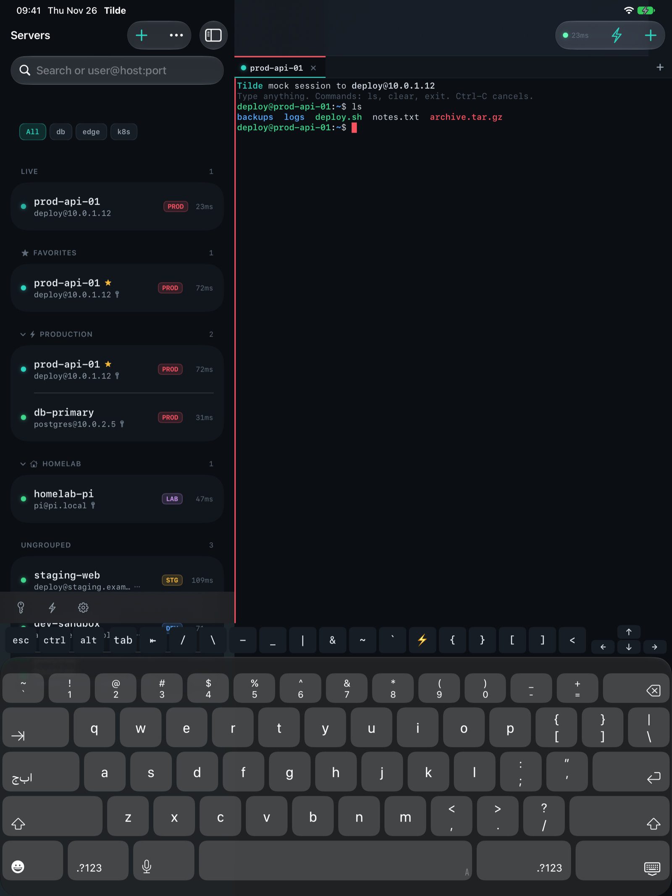
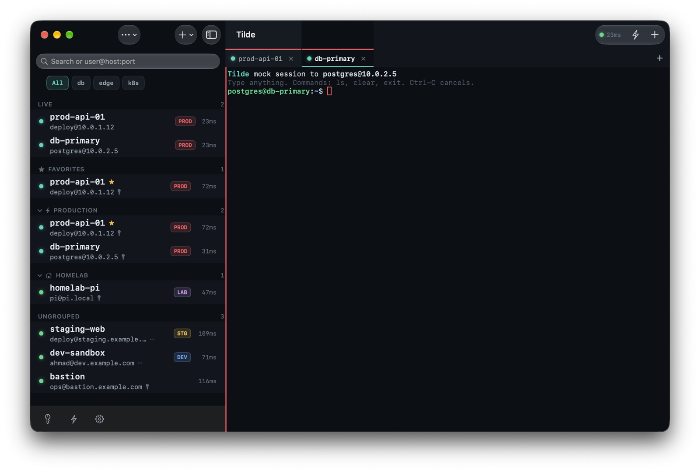
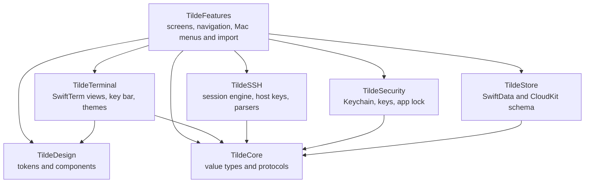

<p align="center">
  
</p>

<h1 align="center">Tilde</h1>

<p align="center">
  <strong>A fast, native SSH client and terminal for iPhone, iPad and Mac.</strong><br>
  Free and open source. Servers sync over iCloud, secrets stay in the Keychain, nothing phones home.
</p>

<p align="center">
  <a href="https://github.com/ahmadrezaei/tilde-ssh/actions/workflows/ci.yml"></a>
  <a href="LICENSE"></a>
  
  
  <a href="CODE_OF_CONDUCT.md"></a>
</p>

Tilde is an **SSH client** and **terminal** built for the people who get paged: SREs, sysadmins, homelab tinkerers and anyone who has typed `cd ~` today. It runs natively on **iPhone**, **iPad** and **Mac**, syncs your server list with **iCloud sync**, and keeps passwords and keys in iCloud Keychain, which is end-to-end encrypted. There is no account to create and no analytics.

> **Status:** version 1.0. Everything listed under Features is implemented and covered by the test suite. The [roadmap](#roadmap) lists what is not in 1.0 yet (port forwarding, SFTP, Mosh and two-factor prompts among them).

<p align="center">
  
  &nbsp;
  
  &nbsp;
  
</p>

## Features

- **Servers** with groups, tags, favorites, search and live reachability. Production servers are color-coded so you never type into the wrong box.
- **Quick Connect:** type `user@host:port` (or paste `ssh -p 2222 -J bastion deploy@10.0.4.12`) and go.
- **A real SSH keyboard** on iPhone and iPad: Esc, Ctrl, Alt, Tab, arrows, `| ~ / -`, F-keys and snippets, with sticky modifiers and flick-for-alternates. Hardware keyboards get Option-as-Meta and slim shortcuts.
- **Terminal:** xterm-256color and truecolor, scrollback, find, three themes (Tilde Night, Tilde Day and a high-contrast one), SF Mono or Menlo, and pinch or ⌘+ / ⌘- to resize the font.
- **Tabs and a full menu bar** on iPad and Mac, with ⌘1 to ⌘9, find in scrollback, multiple windows and Settings.
- **Keys:** generate Ed25519 (or ECDSA / RSA), import OpenSSH and PEM keys including passphrase-protected ones, copy or share the public key, install it on a server, export it behind device authentication.
- **Host key verification** that stops loudly: a changed fingerprint aborts the connection before any credential is sent. A **Known Hosts** list shows every pinned key, and pins sync across your devices.
- **Snippets** with placeholders, a palette to insert or run them, and a few examples to start from.
- **Jump host** (ProxyJump, single hop), auto-reconnect with backoff, and one-switch tmux attach.
- **Import** `~/.ssh/config` and `known_hosts` files, with a preview and duplicate detection.
- **Face ID / Touch ID** app lock, a privacy cover in the app switcher, multi-line paste confirmation and a clipboard that clears itself.
- **iCloud sync** for server metadata (CloudKit private database). Passwords and private keys never touch CloudKit.

## Screenshots

| iPhone: terminal and key bar | iPhone: servers | iPhone: key manager |
|---|---|---|
|  |  |  |

| iPhone: Known Hosts | iPhone: Settings |
|---|---|
|  |  |

**iPad** (server list in the sidebar, tabs and the key bar in the detail column):



**Mac** (sidebar, tab strip and a terminal per tab):



The screenshots use demo servers (`prod-api-01`, `db-primary` and so on) and a mock session, not real hosts. Interactive mockups of every screen are in [`design/mockups.html`](design/mockups.html); open the file in a browser.

## Install

**App Store:** _link coming soon_ (`https://apps.apple.com/app/id0000000000`). Free, no in-app purchases.

**TestFlight:** _link coming soon_.

### Build from source

Requirements: Xcode 27.1 (Swift 6.4) and iOS / iPadOS / macOS 26 or later. [XcodeGen](https://github.com/yonaskolb/XcodeGen) is only needed if you change `project.yml`.

```sh
git clone https://github.com/ahmadrezaei/tilde-ssh.git
cd tilde-ssh

# Logic and tests, headless (no simulator needed)
cd Packages/TildeKit && swift build && swift test && cd ../..

# The apps
xcodebuild -project Tilde.xcodeproj -scheme Tilde-macOS -destination 'platform=macOS' \
  -skipPackagePluginValidation -skipMacroValidation CODE_SIGNING_ALLOWED=NO build
xcodebuild -project Tilde.xcodeproj -scheme Tilde-iOS -destination 'generic/platform=iOS Simulator' \
  -skipPackagePluginValidation -skipMacroValidation CODE_SIGNING_ALLOWED=NO build
```

`-skipPackagePluginValidation` is needed on the command line because SwiftTerm ships a build-tool plugin. In Xcode, choose **Trust & Enable** once when prompted.

To run on a device or use iCloud, set your own team and identifiers in [`Config/Shared.xcconfig`](Config/Shared.xcconfig) (or a git-ignored `Config/Local.xcconfig`). Forks change that one file; see [`TRADEMARKS.md`](TRADEMARKS.md) before publishing a fork.

## Architecture

All logic lives in one local Swift package, `TildeKit`, split into seven library targets. The two app targets (`Tilde-iOS`, `Tilde-macOS`, native, not Catalyst) are thin shells that share 100% of the Swift code.



- **`TildeCore`** holds the contracts (protocols such as `SessionEngine`, `KnownHostsStore`, `SecretStore`) and mocks, with no dependencies. Every module codes against these, which is what lets the pieces be built and tested independently.
- **`TildeSSH`** wraps [Citadel](https://github.com/orlandos-nl/Citadel) (SwiftNIO SSH) behind an actor. NIO types never leave it.
- **`TildeTerminal`** wraps [SwiftTerm](https://github.com/migueldeicaza/SwiftTerm) for UIKit and AppKit.
- **`TildeStore`** is the only module that touches SwiftData. The rest of the app passes immutable `Sendable` snapshots.

Layout:

```
App/                   iOS and macOS app targets, entitlements, Info.plists, assets, privacy manifest
Config/Shared.xcconfig Bundle id, CloudKit container, keychain group, team (fork-friendly)
project.yml            XcodeGen spec for Tilde.xcodeproj (repo root; only needed if you change targets)
Packages/TildeKit/     All logic and tests
docs/  design/         Design spec, mockups, icon source
fastlane/metadata/     App Store listing text
scripts/               Metadata, dependency and log checks; CI helpers
```

## Security model

Short version, with the full threat table in [`docs/DESIGN.md`](docs/DESIGN.md#64-security-model):

- **Secrets stay in the Keychain.** Passwords and private keys are stored in iCloud Keychain (end-to-end encrypted) and referenced by UUID. They never appear in SwiftData, CloudKit, logs, crash reports or the pasteboard (apart from an explicit copy, which expires).
- **Host keys are pinned (TOFU).** A changed key aborts the handshake before authentication, so no password or signature reaches an impostor. Pins sync across your devices.
- **Metadata does sync.** Server names, hosts and usernames go to your private CloudKit database. They are encrypted by Apple, and end-to-end with Advanced Data Protection.
- **No telemetry.** No analytics, no third-party SDKs, no network calls except the SSH connections you start.
- **Terminal hardening.** OSC 52 clipboard writes are off by default, title sequences are length-limited, and OSC 8 links show their URL before opening.
- **Supply chain.** Dependencies are pinned exactly and checked against an allowlist in CI.

Found a vulnerability? Please follow [`SECURITY.md`](SECURITY.md) instead of opening an issue.

## Roadmap

**v1.0 (current):** servers, Quick Connect, Ed25519 / ECDSA / RSA keys, the key bar, tabs and menus, host key verification and the Known Hosts list, iCloud sync, app lock, snippets, jump host (single hop), `~/.ssh/config` and `known_hosts` import.

**v1.1:** a bundled Nerd Font (Powerline and Starship glyphs), split panes, port forwarding, keyboard-interactive (2FA) auth, agent forwarding, Secure Enclave keys, SFTP browser, iTerm2 theme import, Shortcuts and Spotlight, menu bar quick connect.

**Later:** multi-hop ProxyJump, OpenSSH certificates, FIDO2 keys, shared vaults, Live Activities.

Details and rationale are in [`docs/DESIGN.md`](docs/DESIGN.md#8-mvp-scope-vs-roadmap).

## Contributing

Issues and pull requests are welcome. Start with [`CONTRIBUTING.md`](CONTRIBUTING.md), which covers the module boundaries, how to run the tests, and what a good pull request looks like. Everyone taking part is expected to follow the [Code of Conduct](CODE_OF_CONDUCT.md).

## License

Code is licensed under [Apache-2.0](LICENSE). Third-party notices are in [`NOTICE`](NOTICE).

**The name "Tilde" and the app icon are reserved by the project and are not covered by the license grant.** You are free to fork the code; please rename and re-icon your fork if you distribute it. See [`TRADEMARKS.md`](TRADEMARKS.md).
